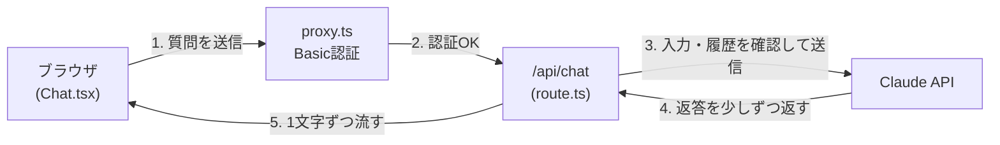

# シンプルAIチャットUI(AIチャット/Bot 案件No.07)

Claude APIに質問を送り、返答を1文字ずつ流れるように表示する、社内向けのシンプルなAIチャットです。

公開URL: https://simple-ai-chat-sepia.vercel.app (Basic認証があります。ID・パスワードは非公開です)

## 1. プロジェクトの概要

### 目的

APIキーを設定するだけで使える、AIチャットのMVP(最小限の製品)を作ります。AIチャットの導入では「まず会話だけできるUIがほしい」という依頼が多いため、その土台になる構成を目指しました。

### 想定ユーザー

社内の業務担当者(非エンジニア)です。

### 主な機能

- 質問を送ると、Claudeの返答がストリーミングで逐次表示される
- 同じ画面にいる間は、会話の履歴を踏まえて返答する
- Enterで送信、Shift+Enterで改行(日本語の変換確定のEnterでは送信しない)
- 応答中は送信ボタンを無効化し、停止ボタンで生成を止められる
- 送る履歴は直近10往復までとし、超えたら注意表示と「新しい会話」ボタンを出す
- AIの返答を、ボタン1つでコピーできる(メールや資料に貼る使い方を想定)
- 入力は2,000文字まで、返答は1,024トークンまで
- エラーは原因別に、利用者が次に何をすればよいか分かる文言で表示する
- Basic認証でアクセスを制限し、APIのクレジットは少額のプリペイド(自動チャージOFF)にして、費用の上限を残高に抑える

### 開発のステップ

| Step | 内容 |
| --- | --- |
| 1 | 雛形作成、README・学習ノート、環境変数の準備 |
| 2 | API Route作成、疎通確認 |
| 3 | チャットUI、ストリーミング表示 |
| 4 | 入力欄(Enter送信・IME対策)、停止ボタン |
| 5 | システムプロンプト、トークン上限、エラー表示 |
| 6 | 不正利用対策(Basic認証、少額プリペイドと自動チャージOFF) |
| 7 | 検証、GitHub公開、Vercelデプロイ |
| 追加 | 回答のコピーボタン |

## 2. 使用技術

| 分類 | 技術 |
| --- | --- |
| フレームワーク | Next.js 16(App Router) |
| 言語 | TypeScript |
| スタイル | Tailwind CSS |
| AI | Claude API、Vercel AI SDK(`ai` 7、`@ai-sdk/react` 4、`@ai-sdk/anthropic` 4) |
| デプロイ | Vercel |

## 3. 全体のフロー



1. 画面から質問を送ると、まず `proxy.ts` がID・パスワードを確認する(画面もAPIも対象)
2. `/api/chat` が、入力が2,000文字以内かを確認し、会話の履歴を直近10往復に絞って、Claude APIへ送る。APIキーを使うのはこのサーバー側だけ
3. Claudeの返答を、できた部分から順に画面へ返す。画面側は `useChat` で受け取り、吹き出しに追記する
4. エラーが起きたら、サーバーが原因の種類(ユーザー起因・こちらの設定起因・外部サービス起因)に分け、画面が日本語のメッセージに変換して表示する。詳しい内容はサーバーのログにだけ残す

### ファイル構成

| ファイル | 役割 |
| --- | --- |
| `proxy.ts` | Basic認証 |
| `app/api/chat/route.ts` | Claude APIの呼び出し、入力と履歴の制限、エラーの分類 |
| `app/components/Chat.tsx` | チャット画面、入力欄、停止ボタン、エラー表示 |
| `app/lib/limits.ts` | 入力文字数・履歴の往復数・返答トークン数の上限 |
| `app/lib/errors.ts` | エラーの種類と、日本語メッセージの対応表 |

## 4. 学んだ事

要約です。ステップごとの詳しい内容とつまずいた点は、[docs/learning-notes.md](docs/learning-notes.md) を参照してください。

- **AI SDK v7の書き方**:古い書き方から変わっており(`system` → `instructions` など)、型の検査(`tsc`)で確かめながら進めた
- **ストリーミング**:返答の完成を待たず、できた部分から表示できる。日本語を1文字ずつ流すには、`smoothStream` の分割単位の指定が必要
- **日本語入力への対応**:変換確定のEnterで送信されないよう、`isComposing` とキーコード229で判定する
- **APIキーの扱い**:`.env.local` に置き、`NEXT_PUBLIC_` を付けない。Gitには上げず、項目名だけを `.env.example` で共有する
- **サーバー側でも制限する**:画面側の制限は、APIを直接呼ばれると素通りする。入力の文字数はサーバーでも確認する
- **エラーの設計**:原因別に3つに分け、画面には詳細を出さずコードだけを渡す
- **Basic認証**:Next.js 16の `proxy.ts` で、画面とAPIの両方を守る。ブラウザが入力内容を覚えるのは仕様
- **標準部品の限界**:textareaの標準のサイズ変更の持ち手は、画面の下に固定した入力欄では動きが逆に見える。Pointer Eventsで自作した

## 5. こだわった点

- **費用が暴走しない作り**:入力2,000文字・履歴10往復・返答1,024トークンの3つの上限に加え、Basic認証と、少額プリペイド(自動チャージOFF)を組み合わせた。上限の数字は `limits.ts` に集約している
- **画面を通らない呼び出しも防ぐ**:`proxy.ts` で `/api/chat` も認証の対象にし、入力の文字数もサーバー側で確認する
- **エラーで困らない**:原因別(ユーザー・設定・外部サービス)に分け、次に何をすればよいかが分かるメッセージにした。APIキーの問題などの内部情報は画面に出さない
- **日本語での使いやすさ**:変換確定のEnterで送信されない、返答が1文字ずつ流れる、停止すると「（停止しました）」と表示される
- **非エンジニアに分かりやすい画面**:AIとユーザーのアイコンと吹き出しの色を分け、入力欄の高さをドラッグで変えられるようにした
- **学習の記録**:ステップごとにコミットし、つまずいた点と原因・解決方法を `docs/learning-notes.md` に残した

## 6. 改善点

今回は入れず、発展版として検討しているものです。

| 機能 | 内容 |
| --- | --- |
| 返答が上限で途切れたときの案内 | 返答が1,024トークンで終わったときに、途中で終了したことを伝え、続きの聞き方を案内する |
| エラー後の入力欄の復元 | エラーで返答が得られなかったとき、送信した文章を入力欄に戻し、打ち直しを不要にする(再送ボタンも併せて検討) |
| ログイン機能 | 社員ごとのアカウントで利用する(今回はID・パスワードを共有するBasic認証) |
| 会話履歴の保存 | リロード後も残し、過去の会話を一覧から選べるようにする |
| 利用回数の制限 | 1人あたりの利用回数を制限し、利用量を記録する |
| ファイル・画像の添付 | 資料や画像を添えて質問できるようにする |
| モデルの切り替え | 用途に応じてモデルを選べるようにする |
| ダークモード | 暗い配色に切り替えられるようにする |

## 7. 検証結果

2026年11月7日に、手元のPCで確認しました。

| 確認項目 | 内容 | 結果 |
| --- | --- | --- |
| ビルド | `npm run lint`、`npm run build` | エラーなし |
| 認証 | 画面を開くとID・パスワードを求められる。間違いでは入れない | 問題なし |
| 認証(API) | 認証なしで `/api/chat` を呼ぶと `401` が返る | 問題なし |
| 会話 | 返答が1文字ずつ流れる。前の発言を踏まえて答える | 問題なし |
| 入力 | Enterで送信、Shift+Enterで改行、変換確定のEnterでは送信しない | 問題なし |
| 停止 | 返答の途中で止められ、「（停止しました）」が表示される | 問題なし |
| コピー | 返答の完了後にボタンが出て、押した返答の文章だけがコピーされる(「（停止しました）」は含まれない)。流れている最中は出ない | 問題なし |
| 入力の上限 | 2,000文字を超えると、カウンターが赤くなり送信できない | 問題なし |
| 履歴の上限 | 上限(動作確認のため一時的に2往復に変更)を超えると案内が出て、古い発言をAIが参照しない。「新しい会話」で画面が空になる | 問題なし |
| エラー(設定) | APIキーを無効にすると、設定の問題を伝えるメッセージが出る | 問題なし |
| エラー(通信) | ネットワークが切れた状態で送ると、通信エラーのメッセージが出る | 問題なし |
| 本番モード | `npm run start` で、認証・会話・停止が動く | 問題なし |
| スマホ幅 | 幅375pxで、画面がはみ出さず、送信と入力欄の高さ変更ができる | 問題なし |
| 公開環境(Vercel) | シークレットウィンドウで、認証の入力画面が出る。正しいID・パスワードで入れて、会話(1文字ずつ表示)と停止が動く | 問題なし |

### 確認できていない点

- 外部サービス起因のエラー(アクセス集中、障害)は、意図的に起こせないため、実際には確認していない。エラーの分類(`classifyError`)のコードのみで対応している

## 8. セットアップ

### 必要なもの

- Node.js
- Anthropic APIキー(Anthropic Consoleで発行)

### 手順

```bash
git clone https://github.com/kasiyuha9528/simple-ai-chat.git
cd simple-ai-chat
npm install
```

`.env.example` をコピーして `.env.local` を作り、値を入力します。

| 環境変数 | 内容 |
| --- | --- |
| `ANTHROPIC_API_KEY` | Anthropic APIキー |
| `BASIC_AUTH_USER` | Basic認証のユーザー名 |
| `BASIC_AUTH_PASSWORD` | Basic認証のパスワード |

```bash
npm run dev
```

`http://localhost:3000` を開いて動作を確認します。

## 9. ライセンス

MIT License。詳細は [LICENSE](LICENSE) を参照してください。
